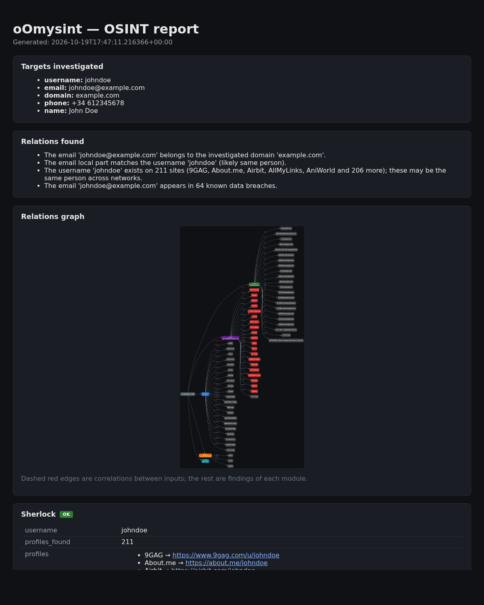
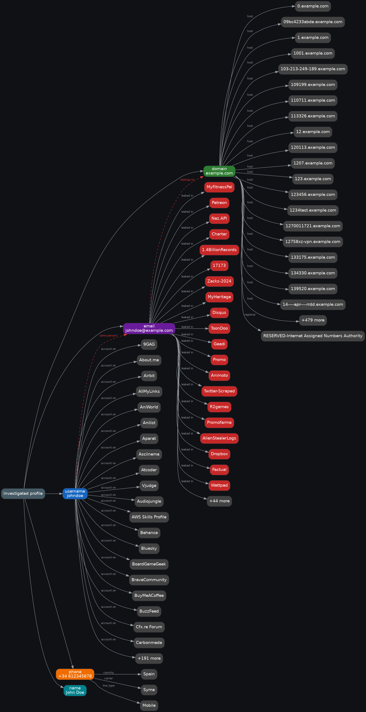

# oOmysint

A small, modular OSINT CLI that collects publicly available information about a
target (username, email, domain, phone number or full name) from several
independent sources, correlates the results, draws a relations graph and
compiles everything into a single report (console, JSON and/or HTML).

Built as a coursework project. **For educational and authorized OSINT use
only** — only investigate targets you own or have explicit permission to
research.



## What it does

| Input        | Module                          | Source |
|--------------|---------------------------------|--------|
| `--username` | `modules/username_lookup.py`    | **Sherlock** (external tool, run as a subprocess and its output parsed) — checks 400+ sites |
| `--email`    | `modules/email_breach.py`       | HaveIBeenPwned API if `HIBP_API_KEY` is set, otherwise the free **XposedOrNot** API |
| `--domain`   | `modules/domain_lookup.py`      | WHOIS + DNS (A / MX / NS / TXT records) |
| `--domain`   | `modules/harvester_lookup.py`   | **theHarvester** (external tool, passive sources only; its JSON output is parsed) — public emails, subdomains, IPs |
| `--phone`    | `modules/phone_lookup.py`       | `phonenumbers` library — country, carrier, line type |
| `--name`     | `modules/name_dorks.py`         | Google dork links for manual follow-up |
| *(all)*      | `modules/correlation.py`        | Finds relations between the results (email ↔ domain, email ↔ username, emails exposed by theHarvester...) |
| *(all)*      | `graph.py`                      | Relations graph with **Graphviz** (`.dot` + `.png`) |

Several inputs can be combined in one run; all results go into a single report.

Every input is validated, and every module fails gracefully: an invalid input,
a missing tool, a missing API key or a network error is reported as a status
inside the report instead of stopping the whole run.

## Installation

```bash
git clone https://github.com/oOmyLoveOo/oOmysint.git
cd oOmysint
python3 -m venv .venv
source .venv/bin/activate
pip install -e .
pip install sherlock-project      # external tool used by --username
```

This installs the `oomysint` command inside the virtualenv
(`python main.py ...` works too).

System tools (preinstalled on Kali; otherwise install them with apt):

```bash
sudo apt install theharvester graphviz
```

Both are optional: if one is missing, its module reports `NOT AVAILABLE` (or
only the `.dot` graph is written) and the rest of the run continues.

Optional: to use HaveIBeenPwned instead of XposedOrNot, copy `.env.example`
to `.env` and set `HIBP_API_KEY` (paid key from https://haveibeenpwned.com/API/Key).

## Usage

```bash
oomysint -u johndoe                       # username on social networks (Sherlock)
oomysint -e johndoe@example.com           # data breaches
oomysint -d example.com                   # WHOIS + DNS + theHarvester
oomysint -p '+34 612345678'               # phone number info
oomysint -n 'John Doe'                    # search links for a full name

# combine everything and save the JSON + HTML reports and the graph
oomysint -u johndoe -e johndoe@example.com -d example.com \
         -p '+34 612345678' -n 'John Doe' -oA output/report
```

> zsh tip: use single quotes for values containing `!` or spaces.

Options:

```
-u, --username USER     Username to search across social networks (Sherlock)
-e, --email EMAIL       Email to check for data breaches
-d, --domain DOMAIN     Domain to analyze via WHOIS + DNS and theHarvester
-p, --phone PHONE       Phone number in international format (+34 ...)
-n, --name NAME         Full name to generate search links for
-oJ FILE                Write the JSON report to FILE
-oH FILE                Write the HTML report to FILE
-oG BASENAME            Write the relations graph (BASENAME.dot + BASENAME.png)
-oA BASENAME            Write everything: BASENAME.json, .html, .dot and .png
--sherlock-timeout N    Timeout for Sherlock in seconds (default: 120)
```

Without any `-o` option the report is printed to the console only.

## Example run (fictitious targets)

`johndoe`, `johndoe@example.com`, `example.com`, `+34 612345678` and
`John Doe` are placeholder values, not a real person. Note that the lookups
themselves are real: Sherlock and the breach API answer for whoever uses the
placeholder `johndoe` on public sites, so many of those hits are unrelated
accounts or false positives — which is exactly the kind of noise an analyst
has to filter.

The output of this run is in [`examples/`](examples/):
[`demo.html`](examples/demo.html), [`demo.json`](examples/demo.json),
[`graph.png`](examples/graph.png) / [`graph.dot`](examples/graph.dot) and the
screenshot above.

```
$ oomysint -u johndoe -e johndoe@example.com -d example.com -p '+34 612345678' -n 'John Doe' \
           -oJ examples/demo.json -oH examples/demo.html -oG examples/graph
[*] Running Sherlock for username 'johndoe'...
[*] Checking data breaches for 'johndoe@example.com'...
[*] Running WHOIS + DNS for 'example.com'...
[*] Running theHarvester for 'example.com'...
[*] Analyzing phone number '+34 612345678'...
[*] Generating lookup dorks for 'John Doe'...
[+] Relations graph written to examples/graph.dot and examples/graph.png
[+] JSON report written to examples/demo.json
[+] HTML report written to examples/demo.html
```

Relations graph of that run (dashed red edges = correlations between inputs):



Invalid input does not stop the run:

```
$ oomysint -u 'bad user!' -d not_a_domain -e noesmail -p '+34 612345678'
[*] Analyzing phone number '+34 612345678'...

== phonenumbers == [OK]
  e164: +34612345678
  ...

Errors:
  - Invalid username: 'bad user!' (letters, digits, '_', '.', '-' (max 39))
  - Invalid email: 'noesmail' (e.g. john@example.com)
  - Invalid domain: 'not_a_domain' (e.g. example.com)
```

## Report structure

Both the HTML and JSON reports contain:

- **targets** — the inputs investigated
- **relations** — correlations found between the results
- **graph** — the relations graph (embedded in the HTML when Graphviz is available)
- **results** — one block per module, with a `source` and a `status`
  (`ok`, `error`, `not_configured`, `not_available`, `manual_followup`)
- **errors** — invalid inputs or modules that failed
- **limitations** (HTML) — what the tool cannot guarantee

## Project structure

```
oOmysint/
├── main.py                    # CLI entry point: validates inputs, runs the registered modules
├── config.py                  # Timeouts, limits, theHarvester sources (all settings in one place)
├── report.py                  # Console / JSON / HTML report output
├── graph.py                   # Relations graph (Graphviz DOT + PNG)
├── modules/
│   ├── __init__.py            # Module registry (MODULES): which input runs which module
│   ├── utils.py               # Input validators/normalizers and helpers
│   ├── username_lookup.py     # Sherlock integration (external tool)
│   ├── harvester_lookup.py    # theHarvester integration (external tool)
│   ├── email_breach.py        # HaveIBeenPwned / XposedOrNot
│   ├── domain_lookup.py       # WHOIS + DNS
│   ├── phone_lookup.py        # phonenumbers
│   ├── name_dorks.py          # Search-link generator
│   └── correlation.py         # Relations between results
├── examples/                  # Demo run (fictitious targets)
├── .env.example               # Optional API key config
├── pyproject.toml / requirements.txt
└── output/                    # Your reports (gitignored)
```

### Adding a new source

1. Create `modules/my_source.py` with one function that receives the input
   value and returns a dict with at least `source` and `status` keys.
2. Add one line to `MODULES` in `modules/__init__.py`, e.g.
   `("my_source", "email", my_source.lookup, "Checking my source for")`.

`main.py` runs it automatically for that input type, and the console and
HTML reports render the new block without any other change.

## Legal and ethical use

- Only public sources are used: no logins, no scraping behind authentication.
- theHarvester runs with passive sources only (they query third-party
  databases, never the target itself).
- Breach checks only return breach *names*, never leaked passwords or data.
- Investigating people without their consent may be illegal (e.g. GDPR in the
  EU). Use the tool on yourself, on fictitious data or with explicit permission.

## Limitations

- Sherlock can give false positives/negatives depending on each site at run time.
- Breach data only covers publicly disclosed breaches (HIBP / XposedOrNot).
- WHOIS data varies by registrar and is often redacted for privacy (GDPR).
- theHarvester results depend on what its passive sources have indexed; long lists are truncated in the report.
- `--name` only produces search links; full names are too ambiguous to resolve automatically.
- Relations are simple matches (hints), not proof that accounts belong to the same person.
- This is a learning project, not a production security tool.
